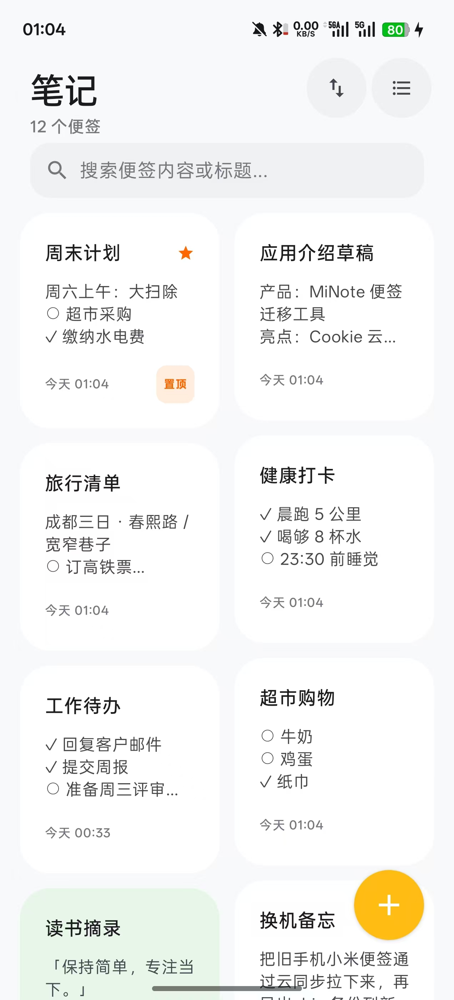
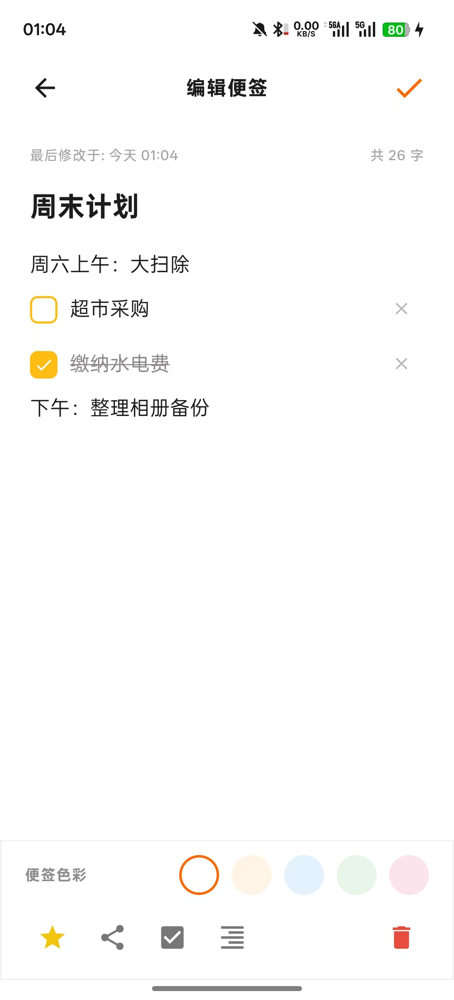
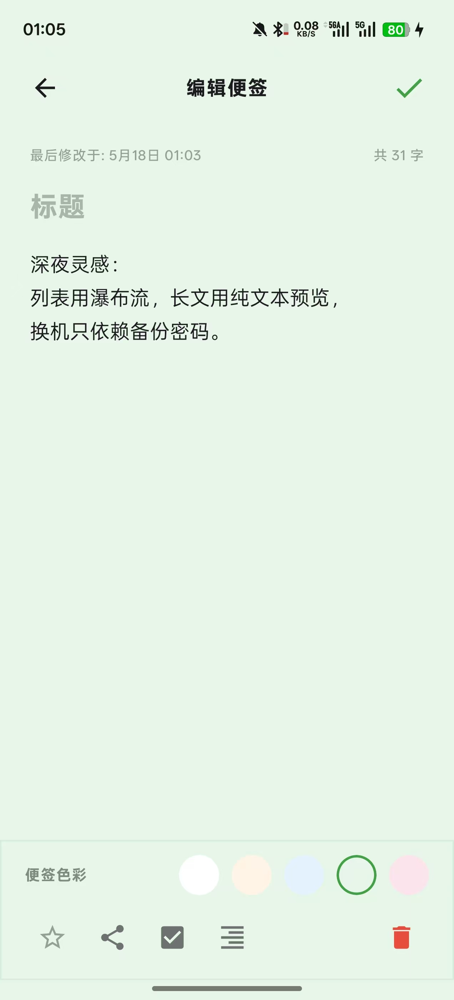
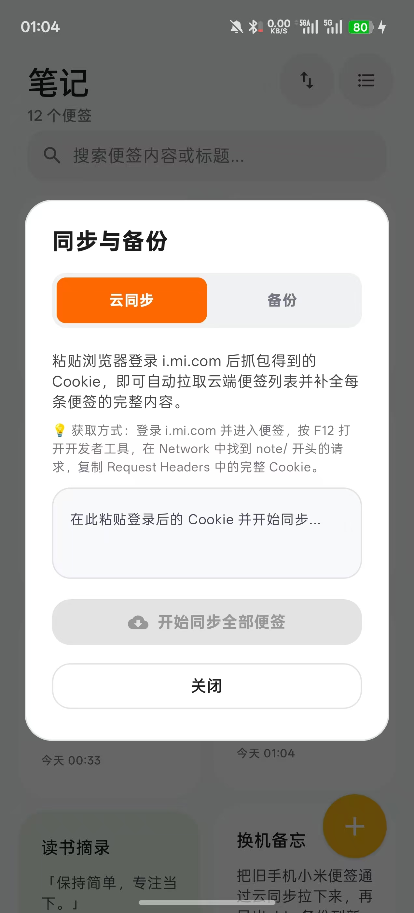
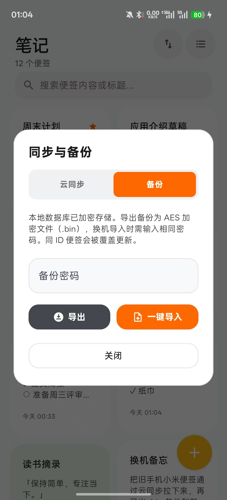
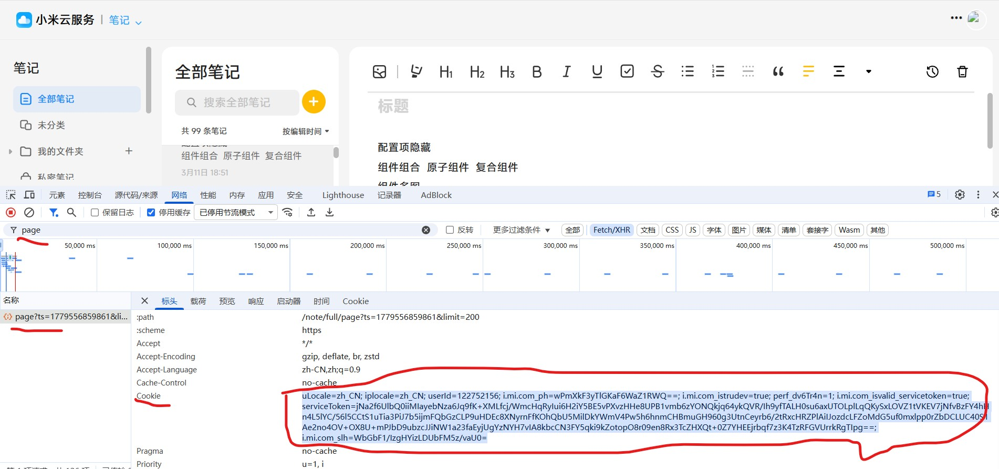

# MiNote

一款用于**从小米云便签迁移便签**的 Android 应用。

## 应用预览

  
  
  

  <em>便签列表 · 待办便签 · 普通便签</em>

  
  

  <em>云端一键同步 · 加密备份导入导出</em>

## 开发背景

我更换了其他品牌手机后，发现大量便签仍留在小米账号里，官方便签**既不好导出，也不方便迁移到新手机**。于是开发了 MiNote，用来：

- 在 App 内登录小米账号，**一键从 i.mi.com 同步**云端便签到本机；
- **补足小米便签缺少导入/导出**的短板，换机时只需「导出 → 导入」即可带走全部便签。

> **说明：** 当前版本主要支持**不带格式的纯文本便签**（普通文本行、待办勾选等）。复杂富文本排版能力仍在完善中。

## 下载安装

直接下载安装包（无需应用商店）：

**[下载 app-debug.apk](https://github.com/Venshao/MiNote/blob/main/.build-outputs/app-debug.apk)**

安装前请在系统设置中允许「安装未知来源应用」。

## 使用方法

### 1. 从小米云同步便签到本地（推荐首次使用）

把小米账号里的云端便签下载到手机：**在 App 内登录** → **自动同步**。

#### 推荐：App 内登录并同步

1. 打开手机 **MiNote**，点击右上角 **云同步** 图标；
2. 在 **「云同步」** 标签页点击 **「登录小米账号并同步」**；
3. 在打开的页面中登录小米账号（与 [i.mi.com](https://i.mi.com) 相同账号）；
4. 登录有效后按提示确认，即可开始同步；
5. 等待完成：App 会拉取云端便签列表与内容（含图片），保存到**本地加密数据库**，之后可离线查看与编辑。

  

> 若提示登录已过期，重新点「登录小米账号并同步」即可。

#### 备用：手动粘贴 Cookie

仅在 App 内登录不可用时使用。

1. 用电脑浏览器打开 [i.mi.com](https://i.mi.com)，登录小米账号；
2. 按 `F12` 打开开发者工具 → **「网络 / Network」**，刷新页面；
3. 点击**任意请求**，在 **「请求标头 / Request Headers」** 中找到 **Cookie** 并完整复制；
4. 回到 MiNote **「云同步」**，展开 **「备用：手动粘贴 Cookie」**，粘贴后同步。

  

> Cookie 相当于登录凭证，请勿发给他人。

### 2. 备份导出（换机前）

1. 打开 **同步与备份** → **备份** 标签页；
2. 设置 **备份密码**（至少 6 位，请牢记）；
3. 点击 **「导出」**，将便签保存为加密的 `.bin` 文件。

### 3. 备份导入（新手机上）

1. 将导出的 `.bin` 文件拷贝到新手机；
2. 打开 MiNote → **备份** → 输入**与导出时相同的密码** → 点击 **「一键导入」** 并选择文件；
3. 导入完成后便签会写入**本地加密数据库**（相同 ID 的便签会被覆盖更新）。

### 4. 日常使用

- 点击右下角 **黄色按钮** 新建便签；
- 点击便签卡片进入编辑，完成后返回即自动保存；
- 右上角可切换**列表 / 瀑布流**视图，顶部搜索框可检索标题与正文。

## 本地开发

**环境要求：** [Android Studio](https://developer.android.com/studio)

1. 用 Android Studio **Open** 本项目目录；
2. 等待 Gradle 同步完成；
3. 连接真机或模拟器，运行 `app` 模块。

## 开源协议

本项目基于 [GNU General Public License v2.0](https://www.gnu.org/licenses/old-licenses/gpl-2.0.html)（**GPL-2.0**）开源，完整协议文本见仓库根目录 [LICENSE](LICENSE) 文件。

- 你可以自由使用、修改和分发本软件（包括商用），但衍生作品须同样以 GPL-2.0 开源并提供源代码。
- 本软件按「原样」提供，不提供任何担保。

本项目与小米公司无官方关联。
